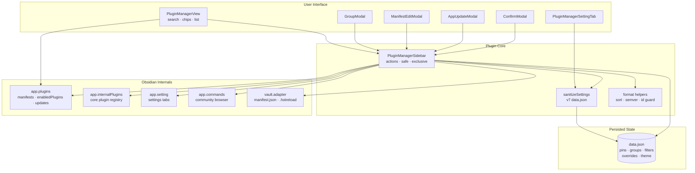
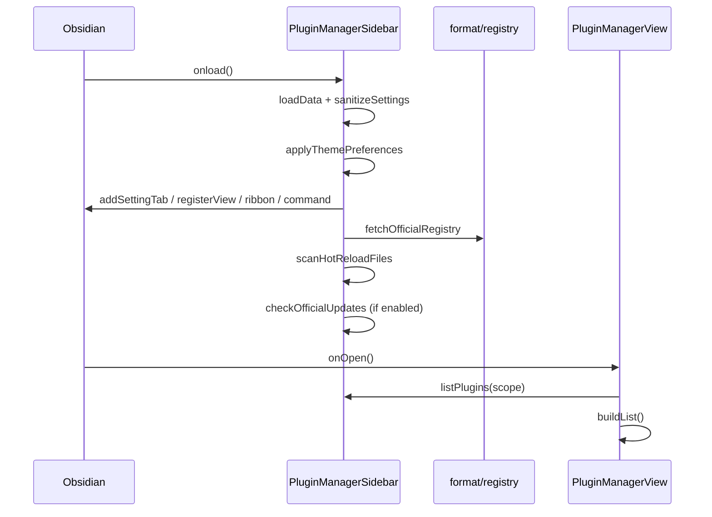
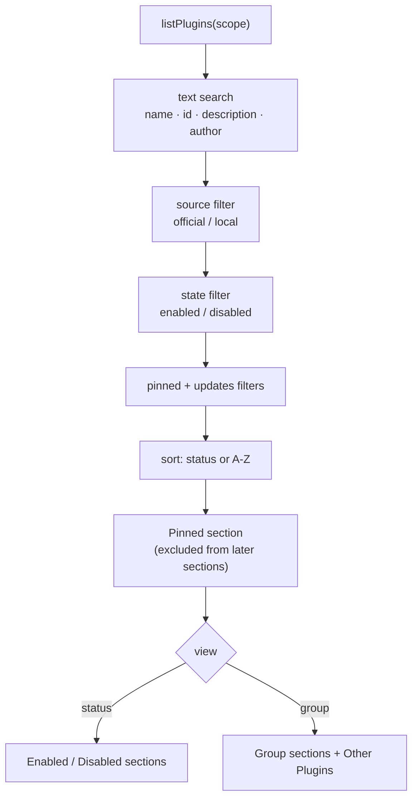

# System Architecture (`ARCHITECTURE.md`)
> **1-Line Summary:** Plain-English map of how the sidebar, Obsidian internals, persisted settings, and group/update features fit together, plus the checks and recipes needed to change it safely.

## 1. High-Level Visual System Map


## 2. Tech Stack & Why We Chose It
* **Language:** TypeScript 5.8, `strict`, bundled to CommonJS `main.js` by esbuild.
* **Host:** Obsidian plugin API, `minAppVersion` 1.1.0, desktop and mobile.
* **State:** One `data.json` document, version 7, sanitized on every load.
* **Network:** `requestUrl` for the community registry, the desktop release feed, and the GitHub releases fallback.
* **No framework:** plain DOM through Obsidian's `createEl`/`createDiv`, so the sidebar inherits every theme without a stylesheet dependency on a UI library.

## 3. Module Responsibilities
### [MODULE: Entry-And-Actions] | Aliases: main.ts, onload, exclusive, safe
> **1-Line Summary:** `main.ts` owns lifecycle, every plugin action, host adapters, and the public helpers the view calls.
* **Owns:** loading and saving settings, registry fetch, hot-reload scan, update checks, enable/disable, group bulk actions, uninstall, settings shortcuts, group editor.
* **Must not:** build DOM for the sidebar or dialogs; it exposes actions and state only.
* **Code Anchors (Grep Targets):** `src/main.ts` -> `onload`, `exclusive`, `safe`, `togglePlugin`, `bulkGroup`, `openGroupEditor`

### [MODULE: Sidebar-View] | Aliases: plugin-manager-view.ts, render, buildList, addRow
> **1-Line Summary:** The `ItemView` that draws the header controls, stats bar, updates section, pinned section, and filtered rows.
* **Owns:** search debounce, chip state, group dropdown, list grouping, row DOM, context menu, scroll preservation.
* **Must not:** mutate plugin state directly; every action is delegated to `PluginManagerSidebar`.
* **Code Anchors (Grep Targets):** `src/views/plugin-manager-view.ts` -> `render`, `buildList`, `addSection`, `addRow`, `openMenu`

### [MODULE: Settings-Sanitizer] | Aliases: utils/settings.ts, sanitizeSettings, defaults
> **1-Line Summary:** Validates any stored blob into the exact v7 settings shape, including groups, overrides, and filter enums.
* **Owns:** allowed enum values, plugin-id filtering, prototype-pollution keys, override length caps, group id uniqueness.
* **Must not:** read files or call Obsidian; it is a pure function over `unknown`.
* **Code Anchors (Grep Targets):** `src/utils/settings.ts` -> `sanitizeSettings`, `overrideList`, `groupList`

### [MODULE: Format-Helpers] | Aliases: utils/format.ts, sorters, semver, ids
> **1-Line Summary:** Shared constants plus id sanitation, sort comparators, semver comparison, and error formatting.
* **Owns:** `VIEW_TYPE`, registry URLs, `sanitizePluginId`, `byEnabledThenName`, `byName`, `compareSemver`, `errMsg`, `sleep`.
* **Must not:** touch the DOM or settings.
* **Code Anchors (Grep Targets):** `src/utils/format.ts` -> `sanitizePluginId`, `compareSemver`, `byEnabledThenName`

### [MODULE: Obsidian-Internal-Types] | Aliases: utils/obsidian-internals.ts, app.plugins, app.setting
> **1-Line Summary:** Declares the optional, untyped host surfaces the bundle relies on, so TypeScript can check every adapter call.
* **Owns:** plugin manager, internal plugins, settings tabs, commands, Electron shell, `openWithDefaultApp`.
* **Must not:** be imported at runtime as a value; it is types only.
* **Code Anchors (Grep Targets):** `src/utils/obsidian-internals.ts` -> `PluginManagerApi`, `InternalPluginsApi`, `SettingApi`, `AppWithInternals`

### [MODULE: Dialogs] | Aliases: modals/, GroupModal, ManifestEditModal, ConfirmModal, AppUpdateModal
> **1-Line Summary:** Four focused dialogs: group editing, metadata editing, destructive confirmation, and the app update prompt.
* **Owns:** their own DOM, validation notices, and the callbacks they receive.
* **Must not:** save settings themselves; callbacks own persistence.
* **Code Anchors (Grep Targets):** `src/modals/group-modal.ts` -> `GroupModal.onOpen`, `src/modals/manifest-edit-modal.ts` -> `ManifestEditModal.onOpen`

## 4. Settings Shape (v7)
```json
{
  "version": 7,
  "pinned": ["quickadd"],
  "groups": [{ "id": "g...", "name": "Study", "plugins": ["spaced-repetition"] }],
  "view": "status",
  "scope": "community",
  "sourceFilter": "all",
  "stateFilter": "all",
  "pinnedOnly": false,
  "updatesOnly": false,
  "selectedGroup": "all",
  "sortBy": "status",
  "glassmorphism": true,
  "autoCheckUpdates": true,
  "overrides": { "dataview": { "name": "Data", "description": "…" } }
}
```
* `overrides` is keyed by sanitized plugin id and capped at 100/100/500 characters.
* `groups` keeps ids even when a member plugin is not currently installed, so a temporarily missing plugin is not silently dropped.
* Unknown keys are discarded on the next save; there is no forward-compatibility promise beyond `version`.

## 5. Data Flow: Load And First Render
### [FLOW: Startup-Sequence] | Aliases: onload, registry, hot reload, auto update
> **1-Line Summary:** Settings load and sanitize first, the view registers, then the registry and hot-reload scan run before an optional update check.

* Registry fetch failure is non-fatal: `registryLoaded` stays false, so rows show no Official/Local badge rather than the wrong one.
* The first render never waits for the update check.

## 6. Data Flow: Toggle One Plugin
### [FLOW: Single-Toggle] | Aliases: enable, disable, verify, exclusive
> **1-Line Summary:** An exclusive action calls the right host API, verifies the resulting state, then refreshes every open view.
* **Community plugin:** `enablePluginAndSave` / `disablePluginAndSave` when available, otherwise the plain `enablePlugin` / `disablePlugin` plus `saveConfig`.
* **Core plugin:** `setEnabled`, then `enable`/`disable`, then a direct `enabled` flag as the last fallback.
* **Verification:** after the call, the manager re-reads `enabledPlugins.has(id)` (or the core object) and throws when the state did not change.
* **Self-guard:** the view blocks the switch, the menu omits the item, and `uninstallPlugin` refuses the manager's own id.
* **Code Anchors (Grep Targets):** `src/main.ts` -> `exclusive`, `applyEnabled`, `toggleCorePlugin`, `togglePlugin`

## 7. Data Flow: List Filtering And Grouping
### [FLOW: Filter-Pipeline] | Aliases: search, filters, pinned, sections
> **1-Line Summary:** Inventory → search/filters → sort → pinned section → view-specific sections.

* The stats bar is computed from the unfiltered scope list, so it always describes the scope, not the current query.
* The updates section only appears when state is all/enabled and source is all/official.

## 8. Data Flow: Metadata Editing
### [FLOW: Manifest-Versus-Override] | Aliases: local manifest, official overlay, reset
> **1-Line Summary:** Local plugins get their `manifest.json` rewritten; official and core plugins get a `data.json` override.
* **Local path:** read `<configDir>/plugins/<id>/manifest.json`, merge name/author/description, write with two-space indentation, then update the in-memory manifest.
* **Override path:** write `settings.overrides[id]`, save, refresh. The original manifest is untouched.
* **Reset:** deleting the override and saving restores the host's values on the next render.
* **Why split:** Obsidian validates and re-reads official plugin manifests; rewriting them can be reverted by an update and breaks signatures.

## 9. Updates And The Community Registry
### [INTEGRATION: Host-Update-Bridge] | Aliases: updates table, installPlugin, registry, app release
> **1-Line Summary:** Updates come from `app.plugins.updates`; installs go through `app.plugins.installPlugin`; the manager only orchestrates.
* **Registry:** `community-plugins.json` supplies the set of official ids only; it is not a plugin list source and not a version source.
* **Available updates:** every key in `app.plugins.updates` becomes a row with the manifest's current version and the table's new version.
* **Update one/all:** call `installPlugin(repo, version, manifest)`, delete the entry from the table, and refresh; update-all sleeps 40 ms between installs.
* **Obsidian app check:** prefer `desktop-releases.json`, fall back to the GitHub latest release tag, compare with `process.versions.obsidian` or `apiVersion`, then show `AppUpdateModal`.

## 10. Persistence And Concurrency Rules
### [STATE: Settings-Save-Chain] | Aliases: saveChain, ordering, rapid clicks
> **1-Line Summary:** Saves are serialized through one promise chain, and bulk mutations run under a single `busy` flag.
* **Why the chain:** several chips can be clicked quickly; parallel `saveData` calls can land out of order and persist an older settings object.
* **Why `exclusive`:** enabling a plugin can trigger layout events and view refreshes; overlapping bulk operations produce duplicate notices and half-applied groups.
* **View refresh:** `refreshViews()` re-renders every open leaf of `VIEW_TYPE`; scroll position is captured and restored per render.

## 11. Build & Verification
```bash
npx tsc -noEmit -skipLibCheck   # types
npm run lint                    # eslint, must be 0 errors
npm run build                   # tsc + esbuild -> main.js
```
* Manual install: copy `main.js`, `manifest.json`, `styles.css` into `<Vault>/.obsidian/plugins/plugin-manager-sidebar/`.
* `runtime/` is the frozen fallback bundle; never build into it.
* Smoke test: toggle a community plugin, toggle a core plugin, pin, create a group, bulk-disable it, edit an official plugin's name, reset it, and open the community browser.

## 12. Extension Recipes
### [RECIPE: Add-A-Filter] | Aliases: new criterion, chip, settings field
> **1-Line Summary:** Add an enum to `PluginManagerSettings`, sanitize it, add a chip in `render`, and apply it in `buildList`.
1. Extend the type and default.
2. Validate the stored value in `sanitizeSettings` (never trust `data.json`).
3. Add the chip and include it in the Reset condition.
4. Apply the predicate in the filter pipeline, before sorting.

### [RECIPE: Add-A-Row-Action] | Aliases: new button, context menu item, host action
> **1-Line Summary:** Add a method on the plugin, call it through `safe()` from the view, and mirror it in the context menu.
1. Put host access in `main.ts`, guarded by `typeof` checks for optional internals.
2. Reuse `exclusive()` if the action mutates plugin state or the vault.
3. Add `iconButton(...)` on the row and a `Menu` item for discoverability.
4. Report success and failure with a `Notice`; log details with `logError`.

### [RECIPE: Change-Persisted-Shape] | Aliases: migration, settings version, data.json
> **1-Line Summary:** Bump `version`, normalize old fields into the new ones inside `sanitizeSettings`, and keep a default for missing data.
1. Never rename a key without reading the old key first.
2. Keep sanitization total: any input, including `null`, must produce valid settings.
3. Save only after a successful load, and never inside the sanitizer.
