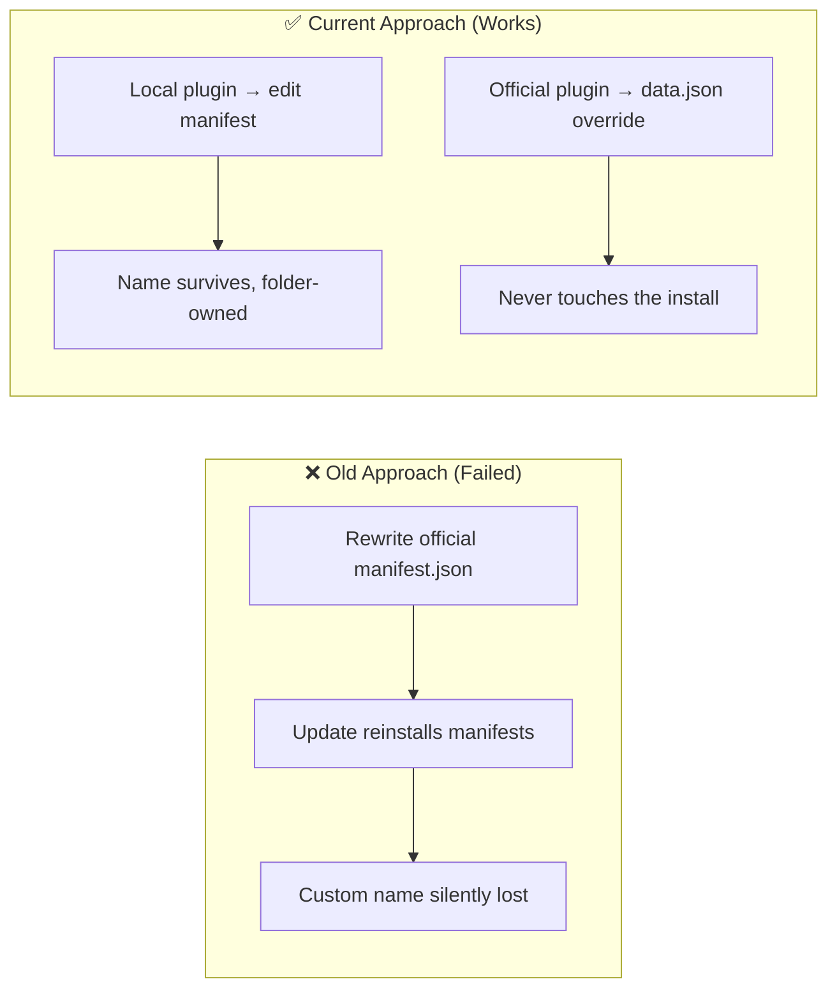

# Architectural Decisions, Pivots & Landmines (`DECISIONS_AND_TRAPS.md`)
> **1-Line Summary:** Why each non-obvious mechanism exists, which broken approach it replaced, and what must never be changed.

## 1. Architectural Decisions & Pivot History

### [DECISION: Duck-Typed-Host-Adapters] | Aliases: app.plugins, internalPlugins, optional APIs, version drift
> **1-Line Summary:** Every internal Obsidian surface is optional and called only after a `typeof` check, instead of assuming a fixed private API.
* **Decision Maker:** `[DECIDED BY: HUMAN]` (the live 2.1.0 bundle)
* **Original User Intention:** Keep working across Obsidian versions where `enablePluginAndSave`, `checkForUpdates`, or `installPlugin` may be missing or renamed.
* **Options Considered:**
  * **Option A (Rejected):** Call `app.plugins` methods directly. One renamed method throws and the whole sidebar fails to render.
  * **Option B (Chosen):** Typed optional interfaces plus capability checks and a fallback chain per operation.
* **Code Anchors (Grep Targets):**
  * `src/utils/obsidian-internals.ts` -> `PluginManagerApi`, `InternalPluginsApi`, `SettingApi`
  * `src/main.ts` -> `applyEnabled`, `toggleCorePlugin`, `checkOfficialUpdates`

### [DECISION: Local-Manifest-Versus-Non-Destructive-Override] | Aliases: metadata editing, overlay, reset defaults, manifest.json
> **1-Line Summary:** Only local/manual plugins get `manifest.json` rewritten; official and core plugins get a `data.json` override.
* **Decision Maker:** `[DECIDED BY: HUMAN]`
* **Original User Intention:** Rename a plugin for clarity without corrupting an official install or having the change reverted by an update.
* **Options Considered:**
  * **Option A (Rejected):** Rewrite every manifest. Official plugins can be re-signed or overwritten on update, and core plugins have no manifest file to edit.
  * **Option B (Chosen):** Direct file edit for local, stored override otherwise, with an explicit Reset.
* **Visual Pivot Map (What Failed vs. What Works):**

* **Code Anchors (Grep Targets):**
  * `src/modals/manifest-edit-modal.ts` -> `ManifestEditModal.onOpen`
  * `src/main.ts` -> `saveLocalManifest`
  * `src/utils/settings.ts` -> `overrideList`

### [DECISION: Host-Owned-Updates] | Aliases: updates table, installPlugin, no custom downloader
> **1-Line Summary:** The plugin reads Obsidian's update table and installs through Obsidian, rather than polling GitHub itself.
* **Decision Maker:** `[DECIDED BY: HUMAN]`
* **Original User Intention:** Surface updates in the sidebar without duplicating version resolution, hashing, or install bookkeeping.
* **Options Considered:**
  * **Option A (Rejected):** Parse each plugin's repository and download release assets. That duplicates host behavior and diverges on beta versions.
  * **Option B (Chosen):** `app.plugins.updates` for discovery, `installPlugin` for installation, delete the entry after success.
* **Code Anchors (Grep Targets):**
  * `src/main.ts` -> `getAvailableUpdates`, `updateSinglePlugin`, `updateAllPlugins`, `checkOfficialUpdates`

### [DECISION: One-Exclusive-Mutation-At-A-Time] | Aliases: busy flag, bulk actions, overlap guard
> **1-Line Summary:** Enabling, disabling, uninstalling, and updating run through `exclusive()`, which refuses a second operation while one is active.
* **Decision Maker:** `[DECIDED BY: HUMAN]`
* **Original User Intention:** Clicking several toggles quickly must not interleave host calls or produce half-applied groups.
* **Options Considered:**
  * **Option A (Rejected):** Fire each action independently. Notices stacked, group bulk operations raced, and the list refreshed mid-mutation.
  * **Option B (Chosen):** A boolean guard plus a "busy" notice, with `refreshViews()` in `finally`.
* **Code Anchors (Grep Targets):**
  * `src/main.ts` -> `exclusive`, `bulkGroup`, `updateAllPlugins`

### [DECISION: Serialized-Settings-Writes] | Aliases: saveChain, out-of-order writes, rapid clicks
> **1-Line Summary:** Saves chain onto one promise so the last write always contains the newest settings object.
* **Decision Maker:** `[DECIDED BY: HUMAN]`
* **Original User Intention:** Rapid filter clicks must not persist an older snapshot after a newer one.
* **Options Considered:**
  * **Option A (Rejected):** `void this.saveData(this.settings)` per change. Concurrent writes can resolve out of order.
  * **Option B (Chosen):** `saveChain = saveChain.then(save).catch(log)`.
* **Code Anchors (Grep Targets):**
  * `src/main.ts` -> `saveSettings`

### [DECISION: Sanitize-On-Load] | Aliases: unknown data, version 7, enums, prototype pollution
> **1-Line Summary:** `sanitizeSettings` rebuilds a valid settings object from `unknown`, enforcing enums, id patterns, caps, and safe keys.
* **Decision Maker:** `[DECIDED BY: HUMAN]`
* **Original User Intention:** A hand-edited or partially written `data.json` must never crash the sidebar or poison prototypes.
* **Options Considered:**
  * **Option A (Rejected):** `Object.assign(DEFAULT_SETTINGS, raw)`. It accepts arbitrary keys, wrong types, and `__proto__` payloads.
  * **Option B (Chosen):** Field-by-field validation with defaults, deduplicated groups, and sanitized override keys.
* **Code Anchors (Grep Targets):**
  * `src/utils/settings.ts` -> `sanitizeSettings`, `groupList`, `overrideList`

### [DECISION: Preserve-Group-Membership-When-Missing] | Aliases: uninstalled plugin, stale ids, group edit
> **1-Line Summary:** Editing a group keeps ids that are not currently installed, appending only new selections.
* **Decision Maker:** `[DECIDED BY: HUMAN]`
* **Original User Intention:** A plugin that is temporarily disabled, removed, or synced later must return to its group automatically.
* **Options Considered:**
  * **Option A (Rejected):** Replace `group.plugins` with the dialog's selection. Any uninstalled member was silently dropped forever.
  * **Option B (Chosen):** Merge selected ids with the missing ones.
* **Code Anchors (Grep Targets):**
  * `src/main.ts` -> `openGroupEditor`

### [DECISION: Structural-Row-Separate-From-Criteria-Row] | Aliases: scope, view, group selector, filter row
> **1-Line Summary:** Scope, view mode, and group selection sit in their own row so filters cannot hide the controls that change what is listed.
* **Decision Maker:** `[DECIDED BY: HUMAN]`
* **Original User Intention:** A user who filtered to "Pinned" must still be able to switch scope or open the group selector.
* **Options Considered:**
  * **Option A (Rejected):** One wrapping chip row. Active filters pushed scope and view off-screen on narrow sidebars.
  * **Option B (Chosen):** Two anchored rows with independent wrapping.
* **Code Anchors (Grep Targets):**
  * `src/views/plugin-manager-view.ts` -> `render`

### [DECISION: Registry-For-Source-Badges-Only] | Aliases: community-plugins.json, official, local, best effort
> **1-Line Summary:** The community registry is used only to label a plugin Official or Local; failure leaves the badge blank, not wrong.
* **Decision Maker:** `[DECIDED BY: HUMAN]`
* **Original User Intention:** Distinguish store plugins from manually installed ones without blocking startup on a network call.
* **Options Considered:**
  * **Option A (Rejected):** Treat a missing registry as "everything is local". That mislabels every official plugin when offline.
  * **Option B (Chosen):** `registryLoaded` gates the badge; no badge is better than a false one.
* **Code Anchors (Grep Targets):**
  * `src/main.ts` -> `fetchOfficialRegistry`, `registryLoaded`
  * `src/views/plugin-manager-view.ts` -> `addRow`

### [DECISION: Self-Protection-In-Three-Places] | Aliases: cannot disable self, locked toggle, uninstall guard
> **1-Line Summary:** The view locks the switch, the menu omits toggle/uninstall, and the actions themselves refuse the manager's id.
* **Decision Maker:** `[DECIDED BY: HUMAN]`
* **Original User Intention:** A user cannot accidentally remove the tool they are using to manage plugins.
* **Options Considered:**
  * **Option A (Rejected):** Only hide the menu item. Keyboard activation or a stale row could still disable the plugin.
  * **Option B (Chosen):** Guard at the UI, the menu, and the mutation.
* **Code Anchors (Grep Targets):**
  * `src/views/plugin-manager-view.ts` -> `addRow`, `openMenu`
  * `src/main.ts` -> `uninstallPlugin`, `bulkGroup`

### [DECISION: Error-Containment-Wrapper] | Aliases: safe(), notices, console, list rendering
> **1-Line Summary:** Row actions run inside `safe()` and list drawing inside `try/catch`, so one failure degrades one action or one render.
* **Decision Maker:** `[DECIDED BY: HUMAN]`
* **Original User Intention:** A plugin with a broken host API should not blank the sidebar or leave an unhandled rejection.
* **Options Considered:**
  * **Option A (Rejected):** Let errors propagate. A single failed toggle stopped the click handler and left a stale spinner state.
  * **Option B (Chosen):** Catch, log with context, show a short notice, continue.
* **Code Anchors (Grep Targets):**
  * `src/main.ts` -> `safe`
  * `src/views/plugin-manager-view.ts` -> `renderList`, `iconButton`

## 2. Landmines & Hard-Won Traps

### [TRAP: Host-Internals-Are-Optional] | Aliases: app.plugins undefined, restricted mode, mobile
> **1-Line Summary:** `app.plugins`, `app.internalPlugins`, `app.setting`, and `app.commands` can all be missing; each call site must check before use.
* **Why It Bites:** On mobile or in a partially initialized workspace, `listPlugins` would throw and the sidebar would show only its error fallback.
* **Rule:** Keep every internal access behind a local `const ... = this.pm` / `this.internals...` check; never index a maybe-undefined object.
* **Code Anchors (Grep Targets):** `src/main.ts` -> `listPlugins`, `openCommunityBrowser`, `openPluginSettings`

### [TRAP: Self-Disable-Kills-The-View] | Aliases: plugin manager disables itself, locked row
> **1-Line Summary:** Disabling `plugin-manager-sidebar` unloads the code mid-action and leaves a dead sidebar.
* **Why It Bites:** The toggle handler disappears with the plugin, so there is no UI left to re-enable it.
* **Rule:** Keep the switch locked, the menu item absent, and both mutation guards in place.
* **Code Anchors (Grep Targets):** `src/views/plugin-manager-view.ts` -> `addRow`, `src/main.ts` -> `uninstallPlugin`

### [TRAP: Settings-Version-And-Shape] | Aliases: data.json v7, version field, migrations
> **1-Line Summary:** The persisted shape is version 7; renaming or reshaping a key without reading the old one silently resets user data.
* **Why It Bites:** `sanitizeSettings` rebuilds from defaults, so an unrecognized key is not an error, it is simply lost.
* **Rule:** Extend the sanitizer with old-key fallbacks before changing the shape, and keep `version` current.
* **Code Anchors (Grep Targets):** `src/utils/settings.ts` -> `sanitizeSettings`, `SETTINGS_VERSION`

### [TRAP: Override-Key-Sanitization] | Aliases: __proto__, constructor, plugin ids
> **1-Line Summary:** Overrides are keyed by sanitized ids and reject `__proto__`, `constructor`, and `prototype`.
* **Why It Bites:** Assigning a user-controlled key straight into a plain object can mutate the prototype chain.
* **Rule:** Keep both the key filter and `sanitizePluginId` when adding another map.
* **Code Anchors (Grep Targets):** `src/utils/settings.ts` -> `overrideList`

### [TRAP: Manifest-Read-Can-Fail] | Aliases: invalid JSON, BOM, missing file
> **1-Line Summary:** `saveLocalManifest` falls back to the in-memory manifest when the file is missing or unparsable.
* **Why It Bites:** A half-written manifest would otherwise abort every metadata save for that plugin.
* **Rule:** Never `JSON.parse` without a `try` and a fallback object.
* **Code Anchors (Grep Targets):** `src/main.ts` -> `saveLocalManifest`

### [TRAP: Hot-Reload-Is-Desktop-Only] | Aliases: .hotreload, mobile, read-only adapter
> **1-Line Summary:** Writing a `.hotreload` marker assumes a writable desktop vault; the action must catch adapter errors and report them.
* **Why It Bites:** On mobile the write fails; an uncaught rejection looks like a dead button.
* **Rule:** Wrap the adapter calls and show `Hot restart failed: <message>`.
* **Code Anchors (Grep Targets):** `src/main.ts` -> `toggleHotReload`

### [TRAP: Explorer-Needs-Electron] | Aliases: window.require, openPath, showInFolder
> **1-Line Summary:** `window.require("electron")` exists only on desktop; every other platform must use `openWithDefaultApp` / `showInFolder` or a notice.
* **Why It Bites:** Calling `require` in a mobile bundle throws and aborts the click.
* **Rule:** Feature-detect `window.require` inside a `try`, then fall back.
* **Code Anchors (Grep Targets):** `src/main.ts` -> `revealInExplorer`

### [TRAP: Refresh-During-Mutation] | Aliases: view refresh, scroll jump, stale rows
> **1-Line Summary:** Views refresh after every exclusive action; the list captures and restores scroll position, and never renders mid-mutation.
* **Why It Bites:** A refresh triggered while a bulk action is halfway through shows a list that disagrees with the host.
* **Rule:** Refresh in `exclusive()`'s `finally`, not inside each loop iteration.
* **Code Anchors (Grep Targets):** `src/main.ts` -> `exclusive`, `src/views/plugin-manager-view.ts` -> `renderList`

### [TRAP: Pinned-Duplication] | Aliases: pinned section, duplicate rows, pinned filter
> **1-Line Summary:** Pinned rows are rendered once, in the Pinned section, and excluded from status and group sections.
* **Why It Bites:** Rendering them twice makes counts wrong and lets two switches target the same plugin.
* **Rule:** Keep the `pinnedSet` exclusion in both view branches.
* **Code Anchors (Grep Targets):** `src/views/plugin-manager-view.ts` -> `buildList`

### [TRAP: Core-Plugin-Shape] | Aliases: getPluginById, plugins map, setEnabled
> **1-Line Summary:** Core plugins expose `setEnabled`, or `enable`/`disable`, or only an `enabled` flag; the fallback order matters.
* **Why It Bites:** Core objects are not `Plugin` instances and differ between versions.
* **Rule:** Try `setEnabled`, then the method pair, then the flag; always verify afterwards.
* **Code Anchors (Grep Targets):** `src/main.ts` -> `toggleCorePlugin`

### [TRAP: Group-Delete-Is-Not-Uninstall] | Aliases: delete group, classification only
> **1-Line Summary:** Deleting a group removes the classification only; the confirmation copy must say so.
* **Why It Bites:** Users assume "Delete" removes plugins, then avoid the feature or panic after using it.
* **Rule:** Keep the "Plugins will not be uninstalled" sentence in the confirm dialog.
* **Code Anchors (Grep Targets):** `src/main.ts` -> `openGroupEditor`

### [TRAP: Frozen-Runtime-Bundle] | Aliases: runtime/, fallback, no rebuild
> **1-Line Summary:** `runtime/main.js` is the emergency fallback and must never be regenerated or hand-edited by a source change.
* **Why It Bites:** Rebuilding overwrites the known-good bundle, removing the user's rollback path.
* **Rule:** Build only to the repository root; treat `runtime/` as read-only.
* **Code Anchors (Grep Targets):** `esbuild.config.mjs`, `runtime/main.js`
