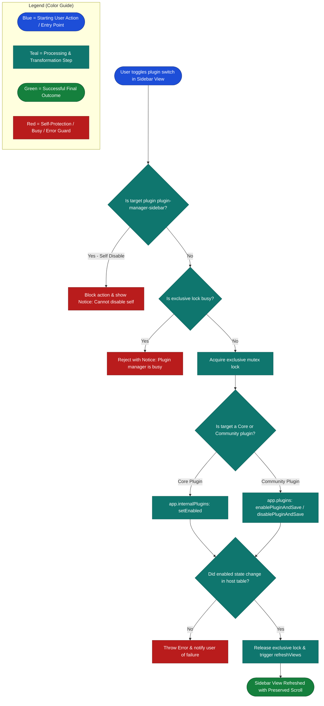

# Visual Feature & Change Log (`VISUAL_LOG.md`)
> **1-Line Summary:** Plain-English, color-coded Obsidian-compatible Mermaid flowcharts explaining how each major flow in Plugin Manager Sidebar operates end to end.

## Feature & Change Flowcharts

### [VISUAL: Single-Plugin-Toggle-And-Verification-Flow] | Aliases: toggle plugin, enable disable, exclusive action
> **1-Line Summary:** How plugin enablement changes are executed exclusively, verified against host state, and safely rolled back if self-targeting.

* **Plain-English Walkthrough:** When the user clicks the toggle switch for a community or core plugin in the sidebar, the manager verifies that it is not attempting to disable itself. It wraps the operation in an `exclusive()` mutex to prevent overlapping mutations. It calls the appropriate host API (`enablePluginAndSave` or `disablePluginAndSave`), verifies that Obsidian's internal `enabledPlugins` set reflected the requested state change, and refreshes the sidebar view while maintaining scroll position.

* **Code Anchors (Grep Targets):**
  * `src/main.ts` -> `togglePlugin`, `applyEnabled`, `exclusive`
  * `src/views/plugin-manager-view.ts` -> `addRow`

---

### [VISUAL: Manifest-Override-And-Safety-Flow] | Aliases: manifest editor, overlay settings, non destructive override
> **1-Line Summary:** How plugin name and description edits are saved non-destructively as overrides for official plugins or written to disk for local plugins.

* **Plain-English Walkthrough:** When a user customizes a plugin's title or description, Plugin Manager Sidebar branches based on origin. Official community plugins and core plugins never have their disk files touched (avoiding checksum/update overwrite issues); instead, their customizations are stored inside `data.json` as runtime overrides. Local development plugins have their local `manifest.json` updated on disk with formatted two-space indentation.

* **Code Anchors (Grep Targets):**
  * `src/modals/manifest-edit-modal.ts` -> `ManifestEditModal.onOpen`
  * `src/main.ts` -> `saveChain`, `applyOverride`
