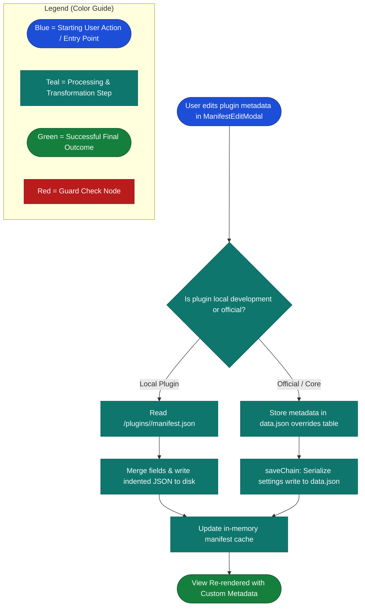
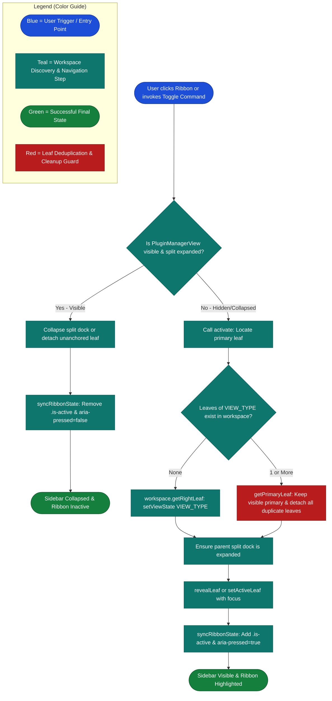
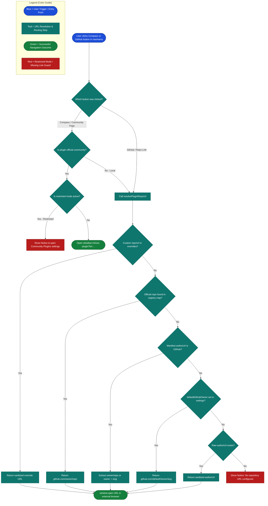
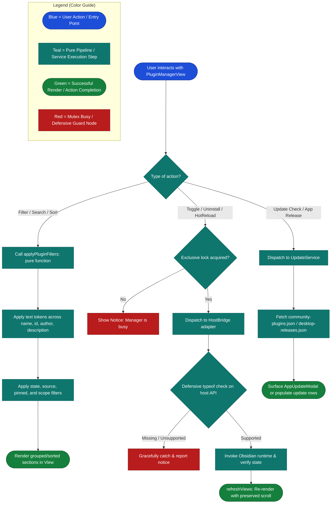
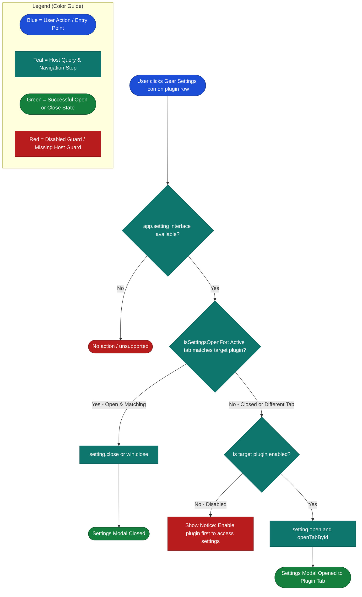

# Visual Feature & Change Log (`VISUAL_LOG.md`)
> **1-Line Summary:** Plain-English, color-coded Obsidian-compatible Mermaid flowcharts explaining how each major flow in Plugin Manager Sidebar operates end to end.

## Feature & Change Flowcharts

### [VISUAL: Single-Plugin-Toggle-And-Verification-Flow] | Aliases: toggle plugin, enable disable, exclusive action
> **1-Line Summary:** How plugin enablement changes are executed exclusively, verified against host state, and safely rolled back if self-targeting.

* **Plain-English Walkthrough:** When the user clicks the toggle switch for a community or core plugin in the sidebar, the manager verifies that it is not attempting to disable itself. It wraps the operation in an `exclusive()` mutex to prevent overlapping mutations. It calls the appropriate host API (`enablePluginAndSave` or `disablePluginAndSave`), verifies that Obsidian's internal `enabledPlugins` set reflected the requested state change, and refreshes the sidebar view while maintaining scroll position.

* **Code Anchors (Grep Targets):**
  * `src/main.ts` -> `togglePlugin`, `applyEnabled`, `exclusive`
  * `src/views/plugin-manager-view.ts` -> `addRow`

---

### [VISUAL: Manifest-Override-And-Safety-Flow] | Aliases: manifest editor, overlay settings, non destructive override
> **1-Line Summary:** How plugin name and description edits are saved non-destructively as overrides for official plugins or written to disk for local plugins.

* **Plain-English Walkthrough:** When a user customizes a plugin's title or description, Plugin Manager Sidebar branches based on origin. Official community plugins and core plugins never have their disk files touched (avoiding checksum/update overwrite issues); instead, their customizations are stored inside `data.json` as runtime overrides. Local development plugins have their local `manifest.json` updated on disk with formatted two-space indentation.

* **Code Anchors (Grep Targets):**
  * `src/modals/manifest-edit-modal.ts` -> `ManifestEditModal.onOpen`
  * `src/main.ts` -> `saveChain`, `applyOverride`

---

### [VISUAL: Sidebar-Controller-Toggle-And-Deduplication-Flow] | Aliases: sidebar toggle, ribbon state sync, leaf deduplication, SidebarController
> **1-Line Summary:** How SidebarController activates, toggles, deduplicates open leaves, and synchronizes ribbon active styling and ARIA state.

* **Plain-English Walkthrough:** When the user clicks the ribbon toggle icon or executes the toggle command, `SidebarController` checks if any sidebar leaf containing `PluginManagerView` is currently visible and uncollapsed. If visible, it collapses the split dock to tuck the sidebar away and turns off the ribbon active state. If not visible, it calls `activate()`, which finds or creates the leaf, purges any duplicate leaves by detaching them, expands the sidebar split, reveals/focuses the leaf, and updates the ribbon icon with `.is-active` and `aria-pressed="true"`.

* **Code Anchors (Grep Targets):**
  * `src/utils/workspace.ts` -> `SidebarController`, `toggle`, `activate`, `getPrimaryLeaf`, `syncRibbonState`
  * `src/main.ts` -> `toggleView`, `activateView`, `sidebar`

---

### [VISUAL: Plugin-Community-Page-And-Repository-Resolution-Flow] | Aliases: repo resolution, community page, github links, show-plugin
> **1-Line Summary:** How Plugin Manager Sidebar navigates to an official plugin's directory entry or resolves its GitHub repository through a hierarchical cascade.

* **Plain-English Walkthrough:** Clicking the Compass action on an official plugin opens Obsidian's internal directory modal (`obsidian://show-plugin?id=<id>`), or guides the user to settings if restricted mode is enabled. Clicking the GitHub action on any plugin resolves a repository URL through a 4-tier hierarchy: (1) user override URL, (2) official registry repo name, (3) manifest `authorUrl` GitHub matching, and (4) default GitHub owner + slug fallback. The resolved URL opens safely in an external browser tab.

* **Code Anchors (Grep Targets):**
  * `src/main.ts` -> `openPluginPage`, `openPluginRepo`, `resolvePluginRepoUrl`
  * `src/views/plugin-manager-view.ts` -> `iconButton`, `openMenu`
  * `src/utils/settings.ts` -> `sanitizeGithubOwner`, `sanitizeHttpUrl`

---

### [VISUAL: Modular-Architecture-And-Filter-Pipeline-Flow] | Aliases: modular architecture, HostBridge, UpdateService, applyPluginFilters
> **1-Line Summary:** How user interactions in PluginManagerView flow through the pure filter pipeline and specialized runtime services.

* **Plain-English Walkthrough:** When the sidebar renders or searches, `PluginManagerView` feeds raw inventories through the pure, standalone `applyPluginFilters` pipeline. All mutations and system inquiries route through `PluginManagerSidebar`'s exclusive lock to dedicated sub-services: `HostBridge` guards private Obsidian runtime interfaces, `UpdateService` handles releases and version checks, and `SidebarController` manages workspace docks and leaf lifecycles.

* **Code Anchors (Grep Targets):**
  * `src/views/plugin-filter.ts` -> `applyPluginFilters`
  * `src/services/host-bridge.ts` -> `HostBridge`
  * `src/services/update-service.ts` -> `UpdateService`
  * `src/main.ts` -> `exclusive`, `safe`

---

### [VISUAL: Plugin-Settings-Window-Toggle-Flow] | Aliases: settings toggle flow, close settings, openPluginSettings
> **1-Line Summary:** How HostBridge checks active settings tab state to either close an open settings modal or open the target tab.

* **Plain-English Walkthrough:** When the user clicks the gear settings icon on a plugin row, `HostBridge` queries `SettingApi` to determine whether settings is already open and active on that plugin's tab. If open, it closes the modal/window immediately, providing a quick toggle shortcut. If closed or active on a different tab, it ensures the plugin is enabled and opens the target plugin settings tab directly.

* **Code Anchors (Grep Targets):**
  * `src/services/host-bridge.ts` -> `openPluginSettings`, `isSettingsOpenFor`
  * `src/utils/obsidian-internals.ts` -> `SettingApi`
